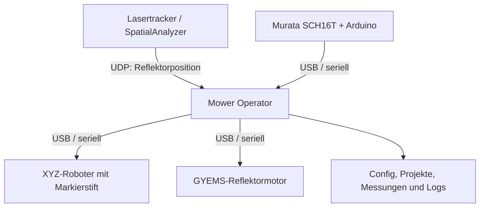

# Mower II – Projektdokumentation

**Dokumenttyp:** Technische Projektbeschreibung und Betriebsübersicht  
**Stand:** 28.10.2026<br>
**Projektstatus:** Entwicklung und Erprobung  
**Projektverantwortlich:** Andreas Wehner  
**Organisation:** Institut für Geodäsie  
**E-Mail:** [andreas.wehner@unibw.de](mailto:andreas.wehner@unibw.de)  
**Repository:** `https://github.com/zhaaz/Mower-II`

> Diese Dokumentation beschreibt den gegenwärtigen Softwarestand. Stellen mit
> `[TODO]` sind bewusst als Platzhalter angelegt. Sie sollten vor einer formalen
> Übergabe, Abnahme oder dauerhaften Inbetriebnahme ergänzt werden.

---

## 1. Kurzbeschreibung

Mower II ist ein mobiler, rechnergestützter Absteckwagen zur automatisierten
Übertragung von Sollkoordinaten auf eine reale Bodenfläche. Zu markierende
Punkte werden aus einer Punkt- oder Projektdatei eingelesen. Ein Lasertracker
bestimmt die Position des am Wagen montierten Reflektors. Ein lokaler
XYZ-Roboter fährt die daraus berechnete Position innerhalb seines Arbeitsraums
an und zeichnet die gewünschte Markierung mit einem Stift auf den Untergrund.

Die Orientierung des Wagens wird mit einem Murata SCH16T-K01 erfasst. Ein
GYEMS-Drehmotor richtet den Reflektor während des Betriebs automatisch zum
Lasertracker aus. Die zentrale Windows-Anwendung **Mower Operator** verbindet
die Komponenten, führt Kalibrierung und Transformation aus, prüft die
Systemzustände und steuert den Markierablauf.

Der früher verwendete KVH DSP-3100 wurde im aktiven System durch den Murata
SCH16T-K01 ersetzt. KVH-Programmteile können noch als Referenz oder Altbestand
im Repository vorhanden sein, gehören aber nicht mehr zum regulären Ablauf.

## 2. Projektziele

### 2.1 Hauptziele

- Einlesen von Absteckpunkten in einem übergeordneten Projekt- bzw.
  Lasertracker-Koordinatensystem.
- Bestimmung der aktuellen Wagenlage durch Messungen mit einem Lasertracker.
- Transformation der Sollpunkte in das lokale Koordinatensystem des
  XYZ-Roboters.
- Automatisches Anfahren und physisches Markieren erreichbarer Punkte.
- Überwachung der Wagenorientierung und Invalidierung einer nicht mehr
  gültigen Transformation.
- Automatische Nachführung des Reflektors zum Lasertracker.
- Nachvollziehbare Speicherung von Projekten, Messergebnissen, Einstellungen
  und Logs.

### 2.2 Abgrenzung

Das Programm ersetzt keine sicherheitsgerichtete Maschinensteuerung. Die
Software prüft Zustände und Arbeitsraumgrenzen, kann jedoch mechanische
Endschalter, Not-Halt, sichere Spannungsabschaltung und die Aufsicht durch eine
eingewiesene Person nicht ersetzen.

> **TODO – Einsatzgrenzen:** Zulässige Untergründe, Umgebungsbedingungen,
> maximale Neigung, Temperaturbereich und Einsatzgebiet dokumentieren.

## 3. Systemübersicht



### 3.1 Hardwarekomponenten

| Komponente | Aufgabe | Schnittstelle | Aktuelle Softwareparameter |
| --- | --- | --- | --- |
| Bedienrechner | Ausführung von Mower Operator und Bedienung | Windows, USB, Netzwerk | `[TODO: freigegebene Windows-Version und Mindestauflösung]` |
| Lasertracker | Messung der Reflektorposition | UDP über LAN/WLAN | Port standardmäßig `10000` |
| SpatialAnalyzer | Bereitstellung der Trackermesswerte | UDP-Ausgabe | `[TODO: verwendeten Measurement Plan und SA-Version dokumentieren]` |
| XYZ-Roboter | Lokales Positionieren und Markieren | Seriell/USB | Standard `115200 Baud`, Port aus Config |
| Murata SCH16T-K01 | Drehrate und relativer Gierwinkel | Über Arduino Nano ESP32 und seriell/USB | `115200 Baud`, ca. `100 Hz` |
| Arduino Nano ESP32 | Auslesen und Vorverarbeiten des Murata-Sensors | USB-CDC | Passendes Arduino-Boardpaket und USB-Erkennung erforderlich; Ausgabeformat siehe Abschnitt 7.3 |
| GYEMS-Motor | Automatische Reflektornachführung (ARN) | Seriell/USB | Standard `115200 Baud`, Motor-ID aus Config |
| Reflektor | Ziel des Lasertrackers | Optisch | CCR-Radius standardmäßig `19,05 mm` |
| Markierstift | Physische Bodenmarkierung | Mechanisch am XYZ-Roboter | Form, Größe und Höhen aus Config |
| Energieversorgung | Versorgung von Rechner/Steuerungen/Motoren | `[TODO]` | `[TODO: Akkus, Spannungen, Sicherungen und Laufzeit]` |

### 3.2 Mechanischer Aufbau

Der Lasertracker misst den Reflektor, während die zu markierende Position durch
die Stiftspitze definiert wird. Beide Punkte sind mechanisch gegeneinander
versetzt. Dieser Offset wird im lokalen Roboterkoordinatensystem als
`marker_to_reflector_robot` gespeichert und bei Transformation und Markierung
berücksichtigt.

> **TODO – Mechanik:** Gesamtmaße, Gewicht, Radstand, Reflektorhöhe,
> Stifthalterung, XYZ-Verfahrwege und eine bemaßte Aufbauzeichnung ergänzen.

> **TODO – Fotos:** Gesamtansicht, Reflektor/GYEMS, XYZ-Roboter, Murata/Arduino
> und Bedienrechner einfügen.

## 4. Koordinatensysteme und Einheiten

### 4.1 Verwendete Koordinatensysteme

| Bezeichnung | Bedeutung |
| --- | --- |
| LT-/Projektkoordinatensystem | Übergeordnetes System des Lasertrackers bzw. der Absteckpunkte |
| Roboterkoordinatensystem | Lokales XYZ-System des Markierroboters |
| Reflektorposition | Vom Lasertracker gemessener Punkt am Wagen |
| Markerposition | Rechnerisch oder durch Kalibrierung bestimmte Position der Stiftspitze |
| Wagenorientierung | Mit dem Murata relativ zur Transformationslage erfasster Gierwinkel |

Die Software verwendet grundsätzlich:

- Längen in **Millimetern**,
- Winkel in **Grad**,
- Winkelgeschwindigkeiten in **Grad pro Sekunde**,
- Zeitangaben je nach Feld in **Sekunden**, **Millisekunden** oder beim
  Murata-Datenstrom in **Mikrosekunden**.

### 4.2 Transformation

Die Zuordnung zwischen Roboter- und LT-System erfolgt über eine räumliche
Helmert-Transformation. Abhängig von `allow_scale` wird der Maßstab entweder
fest auf 1 gesetzt oder mitgeschätzt. Der geschätzte Maßstab muss innerhalb der
konfigurierten Abweichung von 1 liegen.

Der mechanische Marker-/Reflektoroffset wird separat berücksichtigt. Dadurch
kann der Lasertracker den Reflektor beobachten, obwohl tatsächlich die
Stiftspitze den Sollpunkt markieren muss.

> **TODO – Achsdefinition:** Positive X-, Y- und Z-Richtung von Tracker,
> Roboter und Murata anhand einer Skizze eindeutig dokumentieren.

## 5. Softwarearchitektur

### 5.1 Grundprinzip

```text
Bedienoberfläche
    ↓
Dialoge, Workflows und Services
    ↓
Worker und Receiver
    ↓
Gerätetreiber und Hardware
```

Zeitaufwendige Hardwarezugriffe werden nicht direkt in der GUI ausgeführt.
Worker, Threads und Queues halten die Oberfläche bedienbar und übertragen
Zustände kontrolliert zwischen Hardware- und GUI-Ebene.

### 5.2 Wichtige Projektbereiche

| Bereich | Aufgabe |
| --- | --- |
| `App/` | Hauptfenster, Menüstruktur, Kartenanzeige, Dialoge und anwendungsnahe Services |
| `App/dialogs/` | Initialisierung, Transformation, Kalibrierungen, Testmarkierung und Diagnosen |
| `App/services/` | Projektdateien, Kartenvisualisierung und Reflektornachführung |
| `XYZ_Robot/` | Worker, Statusverwaltung und Befehle des XYZ-Roboters |
| `Lasertracker/` | UDP-Empfang, Datenzustand und Punktmessung |
| `Murata/` | Serieller Treiber, Worker, Status, Drift- und Winkelverarbeitung sowie Tests |
| `GYEMS/` | Kommunikation und Zustandsverwaltung des Reflektormotors |
| `Transformation/` | Helmert-Transformation, Geometrie, Koordinatenabbildung und Transformationsworkflow |
| `config/` | Python-Konfigurationsmodell, Standardwerte, Laden, Migration und Validierung |
| `data/` | Veränderliche Nutzdaten außerhalb des Programmcodes |
| `docs/` | Projekt- und Builddokumentation |
| `KVH_DSP/` | Nicht mehr aktive Altimplementierung des früheren Kreisels |

### 5.3 Hauptanwendung

`App/mower_operator_app.py` ist der Einstiegspunkt des Hauptprogramms. Das
Fenster gliedert sich in:

- Punktliste und Details des ausgewählten Punkts,
- 2D-Karte mit Punkten, Tracker, Wagen, Arbeitsraum, Reflektor und Marker,
- Komponenten- und Systemstatus,
- scrollbar aufgebaute Live-Werte,
- Anzeige der aktuellen Aktion,
- Menüs für Dateien, Geräte, Systemfunktionen und Ansicht.

Die Kartenansicht unterstützt Verschieben, Mausrad-Zoom, Zoom hinein/hinaus,
`Zoom all` und einen Reflektorzoom. Der Reflektorzoom zentriert die Karte auf
die aktuelle Reflektorposition und zeigt mindestens etwa 1 × 1 m Umgebung.

## 6. Bedien- und Prozessabläufe

### 6.1 Empfohlener Gesamtprozess

1. Anlage mechanisch und elektrisch prüfen.
2. Lasertracker und SpatialAnalyzer vorbereiten.
3. Trackerstandpunkt und Absteckpunkte bereitstellen.
4. Mower Operator starten und aktive Config kontrollieren.
5. System über **System → Initialisieren** verbinden und referenzieren.
6. Transformation durchführen und Qualitätsbewertung prüfen.
7. Transformation übernehmen.
8. Erreichbarkeit und Markierparameter kontrollieren.
9. Punkte markieren.
10. Projekt und Messergebnisse speichern bzw. exportieren.
11. Nach dem Einsatz Logs sichern und Komponenten geordnet trennen.

### 6.2 Systeminitialisierung

Der Initialisierungsdialog führt im Wesentlichen folgende Schritte aus:

1. XYZ-Roboter über den Config-Port verbinden.
2. XYZ-Homing durchführen.
3. Lasertracker-UDP-Empfang starten und auf aktuelle Daten warten.
4. Trackerstandpunkt aus dem konfigurierten Pfad laden.
5. Murata verbinden.
6. Murata-Drift bei ruhendem Wagen bestimmen und übernehmen.
7. Murata-Winkel nullsetzen.
8. Transformation durchführen.
9. GYEMS verbinden.
10. ARN-Referenz setzen.
11. Reflektornachführung aktivieren.

Kann der Trackerstandpunkt nicht geladen werden, wird die Initialisierung mit
einer Warnung fortgesetzt. ARN-Referenz und ARN-Aktivierung werden in diesem
Fall übersprungen, weil keine sichere Sollrichtung zum Tracker berechnet werden
kann. Die Software verwendet dafür nicht ersatzweise den Ursprung `(0, 0, 0)`.

### 6.3 Transformationsworkflow

Vor der Transformation gelten mindestens folgende Voraussetzungen:

- XYZ verbunden und gehomt,
- Tracker-UDP aktiv,
- aktuelle Trackerdaten vorhanden,
- XYZ nicht durch einen anderen Auftrag belegt.

Ist `home_z_before_transformation` aktiv, wird die Z-Achse unmittelbar vor der
Transformation neu referenziert und anschließend auf `z_travel_mm` gefahren.
Schlägt dieses Homing fehl oder läuft es in einen Timeout, wird die
Transformation nicht gestartet.

Der Workflow erzeugt die Kalibrierpunkte aus den konfigurierten Basispunkten
und einem Zufallsradius. Jeder Punkt wird vor dem Anfahren gegen den zulässigen
XY-Arbeitsraum geprüft. Am angefahrenen Roboterpunkt wird eine stabile
Trackerposition aufgenommen.

Standardmäßig werden fünf Punkte verwendet. Sind einzelne Messungen nicht
verwendbar, kann mit mindestens vier Punkten gerechnet werden. Bei einem
möglichen Ausreißer werden zulässige Vierpunktkombinationen bewertet und die
beste gültige Lösung ausgewählt. Das Ergebnis wird zunächst nur vorläufig
angezeigt. Erst **Trafo übernehmen** macht es für Markieraufträge gültig.

### 6.4 Punktmarkierung

Eine reguläre Markierung ist nur möglich, wenn:

- XYZ verbunden und gehomt ist,
- eine gültige Transformation vorliegt,
- mindestens ein Punkt geladen ist.

Wird eine Absteckung ohne gültige Transformation gestartet, bietet der
Hinweisdialog direkt die Optionen **Transformation durchführen** und
**Abbrechen** an. Über die erste Option wird der Transformationsworkflow
geöffnet; die Markierung muss nach erfolgreicher Übernahme erneut gestartet
werden.

Der Sollpunkt wird aus dem LT-/Projektkoordinatensystem in das lokale
Roboterkoordinatensystem transformiert. Nur Punkte innerhalb des erreichbaren
Arbeitsraums werden freigegeben.

Der Markierablauf verwendet drei Z-Höhen:

| Parameter | Bedeutung |
| --- | --- |
| `z_mark_mm` | Stift in Markierkontakt |
| `z_clear_mm` | Kurze Abhebehöhe zwischen Teilstrichen einer Markierung |
| `z_travel_mm` | Sichere Höhe für längere XY-Bewegungen |

Ist `home_z_before_each_marking` aktiv, wird Z vor jedem einzelnen
Markierauftrag neu referenziert. So können sich mögliche Schrittverluste nicht
von einer Markierung auf die nächste übertragen.

Optional kann nach einer Markierung erneut der Reflektor gemessen werden. Die
Projektdatei kann dazu Messposition, Abweichungen, Gültigkeit, Warnungen und die
Anzahl der Messversuche speichern.

### 6.5 Testmarkierung

Über **System → Testmarkierung** kann unabhängig von einer Punktliste eine
Markierung an der aktuell gelesenen XYZ-Position ausgeführt werden. Form sowie
optionaler Text und Textgröße sind im Dialog einstellbar. Die Funktion setzt
eine verbundene und gehomte XYZ-Achse voraus.

### 6.6 Marker-/Reflektoroffset-Kalibrierung

Die Kalibrierung bestimmt den geometrischen Vektor zwischen Stiftspitze und
Reflektor. Der Roboter zeichnet feste Kalibrierpunkte und der Lasertracker
misst den oberen Reflektor. Danach werden die realen Markierungen manuell mit
dem Reflektor gemessen. Aus beiden Messreihen wird
`marker_to_reflector_robot` berechnet.

Kalibriermarkierungen werden bewusst mit der doppelten Standard-Markierungsgröße
gezeichnet, damit sie bei der manuellen Messung besser erkennbar sind. Eine
übernommene Kalibrierung wird in der Config gespeichert; Ergebnisdateien liegen
unter `data/messungen/kalibrierung/marker_offset/`.

### 6.7 Markierhöhen-Kalibrierung

Die Markierhöhen-Kalibrierung unterstützt die Festlegung einer geeigneten
Kontakt- und Sicherheitshöhe der Z-Achse.

> **TODO – Verfahrensanweisung:** Verwendeten Stifttyp, Einstellfolge,
> Anpresskriterium, zulässige Höhentoleranz und Prüfmarkierung beschreiben.

### 6.8 Reflektornachführung (ARN)

Die ARN berechnet aus Trackerstandpunkt, aktueller Reflektorposition,
Wagenorientierung und mechanischer Referenz die erforderliche relative
Reflektordrehung. Der Winkelfehler wird proportional in eine
Motorgeschwindigkeit umgesetzt:

```text
speed_cmd_deg_s = kp × error_deg
```

Das Ergebnis wird durch Totband, Maximalgeschwindigkeit, Befehlsintervall und
Vorzeichen begrenzt. Fehlen Trackerstandpunkt, aktuelle Messung, Muratawert,
Referenz oder GYEMS-Verbindung, darf die ARN nicht aktiv regeln. Beim
Deaktivieren wird ein Geschwindigkeitskommando von 0 gesendet.

### 6.9 Manuelle XYZ- und Drehmotorbedienung

Über **XYZ → Manuelle Steuerung** können relative X-, Y- und Z-Bewegungen
sowie absolute Zielpositionen angefahren werden. Das Richtungskreuz entspricht
der Bedienansicht: X+ liegt oben, X− unten, Y− links und Y+ rechts. Die aktuelle
Position wird innerhalb des Dialogs angezeigt und kann dort aktualisiert
werden; ein separater Menüpunkt zum Positionslesen ist nicht vorgesehen.

Das Menü **Drehmotor** enthält die regelmäßig benötigten Funktionen zum
Verbinden, Trennen, Anzeigen des Status und Öffnen der GYEMS-Diagnose. Die
Referenzierung erfolgt kontrolliert während der Systeminitialisierung.
Stoppbefehle bleiben Bestandteil der internen Sicherheits- und
Deaktivierungsabläufe, werden jedoch nicht als eigener Menüpunkt angeboten.

## 7. Schnittstellen und Datenformate

### 7.1 Lasertracker / SpatialAnalyzer

Die Trackerdaten werden per UDP empfangen. Der lokale Empfangsport steht in
`tracker.udp_port`. Für eine Punktaufnahme wird höchstens
`tracker.capture_timeout_s` auf geeignete Daten gewartet.

> **TODO – UDP-Protokoll:** Exaktes Telegrammformat, Dezimaltrennzeichen,
> Reihenfolge der Koordinaten, Einheit, Sender-IP, Empfänger-IP und verwendeten
> SpatialAnalyzer Measurement Plan ergänzen.

> **TODO – Netzwerk:** Freigegebene Netzwerkkonfiguration einschließlich
> Subnetzmaske, LAN/WLAN-Regeln und Windows-Firewall dokumentieren.

### 7.2 Trackerstandpunkt

Der Trackerstandpunkt wird standardmäßig aus
`data/tracker/tracker_station.txt` geladen. Die Einleselogik akzeptiert drei
numerische Werte, die durch Leerzeichen, Komma, Semikolon oder Tabulator
getrennt sein können.

Beispiel:

```text
1234.567 2345.678 1567.890
```

### 7.3 Murata / Arduino

Der Arduino sendet bei standardmäßig `115200 Baud` eine Zeile je Messsatz:

```text
time_us;gyro_z_dps;yaw_raw_deg
```

| Feld | Bedeutung |
| --- | --- |
| `time_us` | Sensor-/Arduinozeit in Mikrosekunden |
| `gyro_z_dps` | Drehrate um Z in Grad pro Sekunde |
| `yaw_raw_deg` | Roh integrierter Gierwinkel in Grad |

Der Python-Treiber behandelt Zeitstempelüberläufe, Driftkorrektur und einen
Software-Nullpunkt. `direction_sign` erlaubt die Anpassung an die tatsächliche
Einbaurichtung.

> **TODO – Elektronik:** Pinbelegung Murata ↔ Arduino, Spannungsversorgung,
> Pegel, Arduino-Sketch und Firmwarestand dokumentieren bzw. verlinken.

#### Voraussetzungen für den Arduino Nano ESP32

Der aktuell verwendete Murata-Adapter basiert auf einem **Arduino Nano ESP32**.
Auf einem Entwicklungs- oder Service-Rechner müssen dafür installiert sein:

- eine aktuelle Arduino IDE, vorzugsweise Arduino IDE 2.x,
- das zum Arduino Nano ESP32 passende Boardpaket über die Boardverwaltung,
- die vom verwendeten Arduino-Sketch benötigten Bibliotheken,
- die erforderliche USB-/Seriell-Erkennung unter Windows,
- der zum Projekt gehörende und freigegebene Arduino-Sketch.

In der Arduino IDE muss anschließend das Board **Arduino Nano ESP32** ausgewählt
werden. Für Firmware-Upload, Wiederherstellung und Diagnose muss außerdem der
richtige COM-Port bzw. – im Bootloaderfall – das erkannte DFU-/Bootloader-Gerät
verwendet werden.

Für den normalen Betrieb von Mower Operator ist die Arduino IDE nicht
zwingend geöffnet oder aktiv. Entscheidend ist, dass der bereits programmierte
Nano ESP32 von Windows als serielles Gerät erkannt wird und kontinuierlich das
vereinbarte Murata-Datenformat sendet. Die Arduino IDE und das Boardpaket werden
jedoch für die erstmalige Einrichtung, Firmwareänderungen und die Behebung von
Bootloader-/DFU-Problemen benötigt.

> **TODO – Arduino-Abhängigkeiten:** Exakte Version der Arduino IDE, Name und
> Version des Boardpakets, verwendete Sketch-Bibliotheken sowie Speicherort und
> Versionsstand des freigegebenen Sketches ergänzen.

### 7.4 Punktdateien

Über **Punktdatei importieren** können Text- und CSV-Dateien geladen werden.
Das verwendete Mower-II-Punktformat ist zeilenorientiert. Eine Punktzeile hat
folgenden Aufbau:

```text
Punkt-ID  X  Y  Z  Markierungsart  "optionaler Markierungstext"
```

| Position | Feld | Pflicht | Beschreibung |
| ---: | --- | :---: | --- |
| 1 | Punkt-ID | Ja | Eindeutige Bezeichnung des Punkts, beispielsweise `P_1` |
| 2 | X | Ja | X-Koordinate in Millimetern |
| 3 | Y | Ja | Y-Koordinate in Millimetern |
| 4 | Z | Ja | Z-Koordinate in Millimetern |
| 5 | Markierungsart | Nein* | Numerischer Markierungscode von `1` bis `4` |
| 6 | Markierungstext | Nein | Frei wählbarer Text in doppelten Anführungszeichen |

\* Im empfohlenen Standardformat wird die Markierungsart immer angegeben.
Fehlt sie in einer älteren oder vereinfachten Datei, verwendet das Programm
automatisch `1 = Plus`.

Die Felder werden durch ein oder mehrere Leerzeichen getrennt. Zusätzlich
werden Tabulatoren, Semikolon und alte komma-separierte Formate unterstützt.
Als Dezimaltrennzeichen sind Punkt und Dezimalkomma zulässig. Koordinaten
dürfen positiv oder negativ sein. Durch die Anführungszeichen kann der
optionale Markierungstext auch Leerzeichen enthalten. Ist kein Text gewünscht,
kann das Textfeld entfallen bzw. als leerer Text `""` angegeben werden.

Kommentar- und Headerzeilen können mit `//` oder `#` beginnen und enthalten
keine Punktdaten. Ein Inline-Kommentar nach `//` wird ebenfalls ignoriert,
solange er außerhalb des Textes in Anführungszeichen steht. Ein empfohlener
Dateikopf mit drei Beispielpunkten sieht so aus:

```text
// Mower II Punktimport
// Format: Punkt-ID X Y Z Markierungsart "optionaler Markierungstext"
// XYZ in mm
// Point  X  Y  Z  Markierungsart  Text

P_1  1974.158015  -1189.685819  -1300.659017  2  "123"
P_2  2008.582791  -1002.629107  -1300.664921  2  "123"
P_3  1562.204479   -516.751686  -1300.896005  2  "123"
```

Im Beispiel werden die drei Punkte mit der Markierungsart `2` und dem
zusätzlichen Text `123` importiert. Der Text gehört zur auszuführenden
Markierung und ist nicht mit einem allgemeinen Dateikommentar zu verwechseln.

Die Kennziffer wird in `App/stakeout_point.py` auf die in
`XYZ_Robot/marker_shapes.py` definierten Markierungsformen abgebildet:

| Code | Interner Name | Markierungsform |
| ---: | --- | --- |
| `1` | `plus` | Pluszeichen aus einer horizontalen und einer vertikalen Linie |
| `2` | `cross` | Diagonales Kreuz bzw. X |
| `3` | `circle_point` | Kreis mit Mittelpunkt |
| `4` | `plus_circle` | Pluszeichen mit umschließendem Kreis |

### 7.5 Projektdateien

Mower-Projekte werden bevorzugt als `*.mower.json` gespeichert. Sie enthalten:

- Formatkennung und Versionsnummer,
- Speicherzeitpunkt,
- Absteckpunkte und Bearbeitungsstatus,
- gegebenenfalls Nachmessungen und Abweichungen,
- einen Snapshot relevanter Einstellungen,
- ausgewählte Systemstatusinformationen.

Eine beim Speichern vorhandene Transformation wird nach dem erneuten Laden
nicht automatisch als gültig übernommen. Die Transformation muss für die
aktuelle physische Wagenlage neu bestimmt werden.

### 7.6 Automatische Sitzungswiederherstellung

Zusätzlich zum manuellen Projektspeichern führt Mower Operator einen
fortlaufenden Autosave der aktiven Abstecksitzung. Gespeichert wird nach
relevanten Änderungen sowie unmittelbar vor und nach jeder Markierung. Die
Dateien liegen unter:

```text
data/projekte/autosave/
├── aktive_sitzung.mower.autosave.json
└── aktive_sitzung.mower.autosave.bak.json
```

Die Hauptdatei wird zunächst vollständig als temporäre Datei geschrieben und
anschließend atomar ersetzt. Die vorherige Version bleibt als Backup erhalten.
Vor einem Roboterauftrag erhält der betreffende Punkt den Zustand
`in_progress`. Nach der bestätigten Roboterbewegung werden physischer
Markierabschluss, optionale Kontrollmessung und vollständiger Abschluss
getrennt gespeichert.

Nach einem Programmabsturz bietet ein Startdialog das Wiederherstellen oder
Verwerfen der Sitzung an. Eine beim Absturz laufende Markierung wird als
**Status unklar** gekennzeichnet und muss vor einer Wiederholung vor Ort
kontrolliert werden. Hardwarezustände, Homing und Transformation werden nicht
als gültig wiederhergestellt; sie müssen erneut hergestellt bzw. durchgeführt
werden.

## 8. Konfiguration

### 8.1 Speicherort und Bearbeitung

Im Python-/PyCharm-Betrieb wird folgende Datei verwendet:

```text
data/config/mower_config.json
```

In einer gebauten Anwendung liegt die aktive Datei neben der EXE:

```text
MowerOperator/data/config/mower_config.json
```

`config/mower_config.py` definiert Datenmodell, Standardwerte, Migration und
Validierung. Für den normalen Betrieb wird nur die JSON-Datei bearbeitet.
Relative Pfade werden gegen den Projekt- bzw. EXE-Ordner aufgelöst.

Über **System → Config neu laden** kann die JSON-Datei während des Betriebs neu
eingelesen werden. Die Datei wird vollständig geladen und validiert, bevor die
aktive Konfiguration ersetzt wird. Bei einer ungültigen JSON-Datei bleibt die
bisherige Config unverändert aktiv.

Ein erfolgreicher Reload invalidiert aus Sicherheitsgründen eine bestehende
Transformation und deaktiviert eine aktive Reflektornachführung. Geänderte
COM-Port-, Baudraten- oder UDP-Einstellungen werden für bereits geöffnete
Verbindungen erst nach dem Trennen und erneuten Verbinden wirksam.

### 8.2 Konfigurationsbereiche

| Abschnitt | Wichtige Felder | Bedeutung |
| --- | --- | --- |
| `xyz` | `port`, `baudrate` | Serielle Verbindung |
|  | `x_min/max`, `y_min/max`, `z_min/max` | Zulässiger Arbeitsraum |
|  | `default_feedrate`, `fast_feedrate` | Fahrgeschwindigkeiten |
|  | `tolerance_mm` | Positionstoleranz |
|  | `home_z_before_transformation` | Z vor jeder Transformation homen |
|  | `home_z_before_each_marking` | Z vor jeder Markierung homen |
| `tracker` | `udp_port` | Lokaler UDP-Port |
|  | `capture_timeout_s` | Timeout einer Punktaufnahme |
|  | `ccr_radius_mm` | Radius des verwendeten Reflektors |
| `murata` | `port`, `baudrate` | Serielle Verbindung |
|  | `default_drift_seconds` | Dauer der Driftbestimmung |
|  | `direction_sign` | Vorzeichenkorrektur der Einbaurichtung |
| `gyems` | `port`, `baudrate`, `motor_id` | Motorverbindung und Adressierung |
| `arn` | `kp` | Proportionalverstärkung |
|  | `max_speed_deg_s` | Begrenzung der Motorgeschwindigkeit |
|  | `deadband_deg` | Totband gegen Pendeln |
|  | `command_interval_ms` | Mindestabstand der Motorbefehle |
|  | `direction_sign` | Drehrichtung der Mechanik |
| `marker` | `shape`, `size_mm`, `angle_deg` | Form und Geometrie |
|  | `align_to_tracker_axes` | Markierung am LT-System ausrichten |
|  | `measure_after_marking` | Automatische Nachmessung |
|  | `z_mark_mm`, `z_clear_mm`, `z_travel_mm` | Markier- und Sicherheitshöhen |
| `transformation` | `marker_to_reflector_robot` | Kalibrierter mechanischer Offset |
|  | `gyro_invalid_threshold_deg` | Maximal zulässige Winkeländerung |
|  | Qualitätsfelder | Grenzwerte für RMS und Maximalrestklaffung |
|  | `calibration_points` | Lokale Transformationspunkte |
|  | `calibration_random_radius_mm` | Zufällige Variation der Punkte |
|  | `minimum_required_measurements` | Mindestanzahl gültiger Messungen |
|  | `allow_scale`, `max_scale_deviation` | Maßstabsschätzung und Plausibilitätsgrenze |
| `paths` | Tracker-, Log-, Projekt- und Messpfade | Externe Datenablage |

### 8.3 JSON-Hinweise

- Boolesche Werte werden als `true` und `false` geschrieben.
- Textwerte müssen in doppelten Anführungszeichen stehen.
- Zwischen Einträgen ist ein Komma erforderlich.
- Hinter dem letzten Eintrag eines Objekts steht kein Komma.
- COM-Ports und andere maschinenspezifische Werte können je Rechner abweichen.
- Vor größeren Änderungen sollte die Config gesichert werden.

## 9. Transformationsqualität und Freigabe

Die Qualität wird anhand der Restklaffungen der verwendeten Messpunkte
bewertet:

- **RMS:** mittlere Gesamtgröße der Restklaffungen,
- **Max:** größte Restklaffung eines einzelnen verwendeten Punktes.

Für jede Stufe müssen beide Grenzwerte eingehalten werden:

| Bewertung | RMS | Maximalrestklaffung | Technische Freigabe |
| --- | ---: | ---: | --- |
| **SEHR GUT** | ≤ 0,05 mm | ≤ 0,10 mm | Ja |
| **GUT** | ≤ 0,10 mm | ≤ 0,20 mm | Ja |
| **OK** | ≤ 0,25 mm | ≤ 0,50 mm | Ja |
| **PRÜFEN** | mindestens ein OK-Grenzwert überschritten | mindestens ein OK-Grenzwert überschritten | Nein |

Die Tabelle zeigt die gegenwärtigen Standardwerte. Maßgeblich ist immer die
aktive JSON-Config. Die Transformation wird nur freigegeben, wenn mindestens
die Stufe **OK** erreicht wird.

Bei aktivierter Maßstabsschätzung gilt zusätzlich:

```text
|Maßstab - 1,0| ≤ max_scale_deviation
```

Mit `max_scale_deviation = 0.0005` beträgt die maximal zulässige Abweichung
`0,05 %`. Eine Überschreitung ergibt **PRÜFEN (MASSSTAB)**.

Nach einer übernommenen Transformation überwacht der Murata die
Orientierungsänderung. Überschreitet der Betrag der Änderung
`gyro_invalid_threshold_deg` – standardmäßig `0,03°` –, wird die Transformation
ungültig. Vor weiteren Markierungen muss neu transformiert werden.

## 10. Sicherheits- und Fehlerverhalten

### 10.1 Softwareseitige Schutzmaßnahmen

- Markieren nur mit verbundener und gehomter XYZ-Achse.
- Reguläres Markieren nur mit gültiger Transformation.
- Arbeitsraumprüfung vor Transformations- und Markierfahrten.
- Abbruch der Transformation bei fehlenden Mindestmessungen.
- Maßstabs- und Qualitätsprüfung vor Freigabe.
- Invalidierung der Transformation bei zu großer Murata-Winkeländerung.
- Optionales Z-Homing vor Transformation und jeder Markierung.
- Keine ARN-Aktivierung ohne Trackerstandpunkt und mechanische Referenz.
- GYEMS-Stoppkommando beim Deaktivieren der ARN.
- Timeouts und verständliche Fehlermeldungen bei Hardwareabläufen.
- Protokollierung relevanter Zustände und Fehler.

### 10.2 Verantwortung der Bedienperson

- Bewegungsraum vor Homing und Fahrbewegungen freihalten.
- Sichere Stift-, Reflektor- und Kabelbefestigung prüfen.
- Mechanische Endschalter und Not-Halt vor dem Einsatz testen.
- Murata während der Driftbestimmung nicht bewegen.
- Tracker-Linie freihalten und Reflektorsicht kontrollieren.
- Markierhöhe nach Stiftwechsel oder mechanischen Änderungen neu prüfen.
- Bei ungewöhnlichen Geräuschen, Kollision, Datenverlust oder unplausiblen
  Werten den Betrieb sofort stoppen.

> **TODO – Sicherheitskonzept:** Gefährdungsbeurteilung, Not-Halt-Konzept,
> elektrische Absicherung, zulässige Bedienpersonen und Freigabeprozess
> dokumentieren.

## 11. Datenablage

Die Anwendung trennt technische Programmdateien von veränderlichen Nutzdaten:

```text
MowerOperator/
├── MowerOperator.exe
├── _internal/
└── data/
    ├── config/
    │   └── mower_config.json
    ├── tracker/
    │   └── tracker_station.txt
    ├── messungen/
    │   ├── kalibrierung/
    │   └── messplaene/
    ├── projekte/
    │   └── autosave/
    └── logs/
```

Der Ordner `_internal` enthält technische PyInstaller-Bestandteile und wird
nicht manuell bearbeitet. Der Ordner `data` muss bei Sicherung, Rechnerwechsel
und Programmaktualisierung erhalten bleiben.

> **TODO – Datensicherung:** Speicherort, Intervall, Aufbewahrungsdauer und
> verantwortliche Person festlegen.

## 12. Logging und Diagnose

Für jeden Programmstart wird im konfigurierten Logverzeichnis eine Logdatei
angelegt. Sie enthält unter anderem:

- Start- und Importfehler,
- Verbindungs- und Trennvorgänge,
- Statusänderungen,
- Transformations- und Kalibrierabläufe,
- Markieraufträge,
- Warnungen, Timeouts und Exceptions.

Diagnosemöglichkeiten im Programm:

- Komponenten- und Systemstatus im Hauptfenster,
- Live-Werte von XYZ, Tracker, Murata und ARN,
- Statusdialoge für Murata und GYEMS,
- Murata-Testfenster,
- aktive Config anzeigen,
- Logdatei öffnen.

## 13. Tests

### 13.1 Murata-Softwaretests

```powershell
python -m unittest Murata.test_murata -v
```

Diese Tests prüfen Softwarelogik ohne angeschlossene Hardware.

### 13.2 Murata-Hardwaretest

```powershell
python -m Murata.test_murata_hardware --port COM9
```

Optional mit Driftmessung:

```powershell
python -m Murata.test_murata_hardware --port COM9 --drift-seconds 10
```

Der Test kontrolliert Verbindung, gültige Datensätze, Datenrate, numerische
Werte und Software-Nullpunkt. Der verwendete COM-Port ist an den Rechner
anzupassen.

### 13.3 Empfohlene Systemtests

Der softwareseitige Config-Reload kann zusätzlich automatisiert geprüft
werden:

```powershell
python -m unittest tests.test_config_reload -v
```

Der Sitzungs-Autosave kann separat geprüft werden:

```powershell
python -m unittest tests.test_session_autosave -v
```

- Start mit vollständiger und mit fehlerhafter Config.
- Config-Reload mit gültiger und ungültiger JSON-Datei sowie anschließender
  Neuverbindung geänderter Schnittstellen.
- Verbindung und Trennung jeder Komponente.
- XYZ-Homing und Arbeitsraumgrenzen.
- Transformation mit fünf Punkten, einem fehlenden Punkt und einem Ausreißer.
- Ablehnung bei Qualitäts- und Maßstabsüberschreitung.
- Invalidierung bei Murata-Winkeländerung.
- Z-Homing vor aufeinanderfolgenden Markierungen.
- Test aller Markierungsformen und optionaler Texte.
- ARN-Regelrichtung, Totband, Begrenzung und Stoppverhalten.
- Projekt speichern, laden und exportieren.
- Betrieb bei kurzzeitigem Tracker-Datenausfall.
- Darstellung bei kleiner Laptop-Auflösung.

> **TODO – Testprotokoll:** Prüfschritte, Sollwerte, Ergebnis, Datum,
> Softwareversion und prüfende Person als standardisierte Vorlage ergänzen.

## 14. Installation und EXE-Erstellung

### 14.1 Entwicklungsbetrieb

> **TODO – Entwicklungsumgebung:** Exakte Python-Version, Abhängigkeiten und
> Installation der virtuellen Umgebung in einer `requirements.txt` oder
> `pyproject.toml` dokumentieren.

Zusätzlich zur Python-Umgebung wird für Entwicklung und Wartung des
Murata-Adapters die in Abschnitt 7.3 beschriebene Arduino-Umgebung benötigt.
Vor der Inbetriebnahme auf einem neuen Rechner ist zu prüfen, ob der Arduino
Nano ESP32 im Windows-Geräte-Manager ohne Warnsymbol erscheint und ein stabiler
COM-Port zugewiesen wird. Der tatsächlich verwendete Port wird anschließend in
`data/config/mower_config.json` unter `murata.port` eingetragen.

Typischer Start aus dem Projektordner:

```powershell
python -m App.mower_operator_app
```

### 14.2 EXE erstellen

PyInstaller einmalig installieren:

```powershell
python -m pip install pyinstaller
```

Danach im Projektordner:

```powershell
.\build_mower_operator.ps1
```

Falls die lokale PowerShell-Ausführung blockiert ist:

```powershell
Set-ExecutionPolicy -Scope Process -ExecutionPolicy Bypass
.\build_mower_operator.ps1
```

Das Ergebnis liegt unter:

```text
dist/MowerOperator/MowerOperator.exe
```

Auf einen anderen Rechner wird immer der vollständige Ordner
`dist/MowerOperator` kopiert, nicht nur die EXE. Beim Neubau schützt das Skript
einen bereits vorhandenen `data`-Ordner, damit maschinenspezifische Config,
Projekte, Messungen und Logs nicht überschrieben werden.

## 15. Wartung und Versionsverwaltung

Vor einer Änderung:

```powershell
git status
git pull --rebase origin main
```

Nach getesteten Änderungen:

```powershell
git add -A
git status
git commit -m "Kurze Beschreibung der Änderung"
git push origin main
```

Nicht ins Repository gehören insbesondere:

- virtuelle Umgebung `.venv/`,
- `__pycache__/` und `*.pyc`,
- `build/` und `dist/`,
- temporäre Patch- und ZIP-Dateien,
- laufzeitspezifische Logs,
- maschinenspezifische oder sensible Nutzdaten.

> **TODO – Releaseprozess:** Versionsschema, Changelog, Freigabetest,
> Ablageort freigegebener EXE-Versionen und Rückfallstrategie festlegen.

## 16. Bekannte Einschränkungen und offene Punkte

- **Legacy-Code:** KVH-Dateien sind teilweise noch vorhanden und sollten nach
  einer abschließenden Archivierungsentscheidung entfernt oder klar als
  Legacy gekennzeichnet werden.
- **Hardwareabhängigkeit:** COM-Ports können sich zwischen Rechnern ändern.
- **Arduino DFU auf Laptops:** Die USB-Erkennung des Nano ESP32 war auf einzelnen
  Laptops auffällig. Stromversorgung, USB-Energiesparen, Treiber, Portmodus und
  Firmware müssen noch systematisch dokumentiert werden.
- **UDP über WLAN:** Netzwerksegmentierung, Access-Point-Isolation und
  WLAN-spezifische Broadcast-/Unicast-Regeln können den Empfang beeinflussen.
- **Vollständige automatisierte Tests:** Für GUI, Transformation, Markierablauf
  und Fehlerfälle fehlt noch eine umfassende Testsuite.
- **Hardware-in-the-Loop-Test:** Ein reproduzierbarer Gesamttest aller
  Komponenten ist noch als Prüfanweisung zu definieren.

## 17. Ergänzungscheckliste

Die folgenden Informationen sind für eine vollständige Übergabe besonders
wichtig:

- [x] Projektverantwortlicher und Kontaktadresse
- [ ] Freigegebene Hardware- und Softwareversionen
- [ ] Schaltplan, Sicherungen und Energieversorgung
- [ ] Pinbelegung Murata/Arduino und Arduino-Firmware
- [ ] Arduino-IDE-, Boardpaket- und Bibliotheksversionen
- [ ] Mechanische Zeichnungen und Achsdefinitionen
- [ ] SpatialAnalyzer Measurement Plan und UDP-Format
- [x] Verbindliches Punktdateiformat mit Beispielen
- [x] Markierungscode-Tabelle 1 bis 4
- [ ] Kalibrier- und Prüfanweisungen
- [ ] Gefährdungsbeurteilung und Not-Halt-Konzept
- [ ] Wartungsintervalle für Mechanik, Stift und Reflektor
- [ ] Abnahme- und Genauigkeitskriterien
- [ ] Datensicherungs- und Archivierungskonzept
- [ ] Python-Abhängigkeiten und reproduzierbare Entwicklungsumgebung
- [ ] Release-, Update- und Rollbackprozess
- [ ] Lizenz- und Nutzungsbedingungen

## 18. Änderungshistorie dieses Dokuments

| Datum | Version | Änderung | Bearbeiter |
| --- | --- | --- | --- |
| 26.10.2026 | 0.1 | Ausführliche Erstfassung auf Basis des aktuellen Projektstands | `[TODO]` |
| 27.10.2026 | 0.2 | Punktimportformat mit Feldern, Kommentaren und Beispieldaten ergänzt | `[TODO]` |
| 27.10.2026 | 0.3 | Markierungscodes und tatsächliches Parser-Verhalten dokumentiert | `[TODO]` |
| 27.10.2026 | 0.4 | Arduino-Nano-ESP32-Abhängigkeiten und Installationsvoraussetzungen ergänzt | `[TODO]` |
| 27.10.2026 | 0.5 | Projektverantwortlichen, Organisation und Kontaktadresse ergänzt | Andreas Wehner |
| 28.10.2026 | 0.6 | Config-Reload, Transformationshinweis und bereinigte Gerätebedienung dokumentiert | Andreas Wehner |
| 28.10.2026 | 0.7 | Absturzsicheren Sitzungs-Autosave und Wiederherstellungsablauf dokumentiert | Andreas Wehner |

